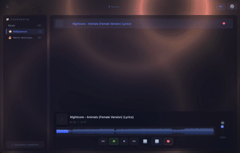
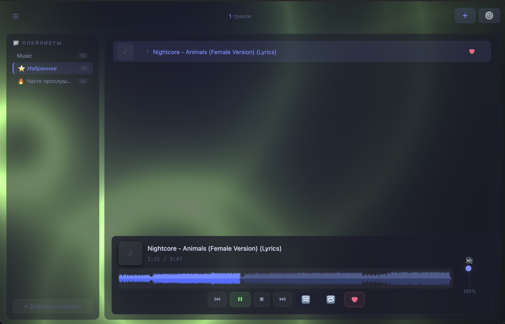
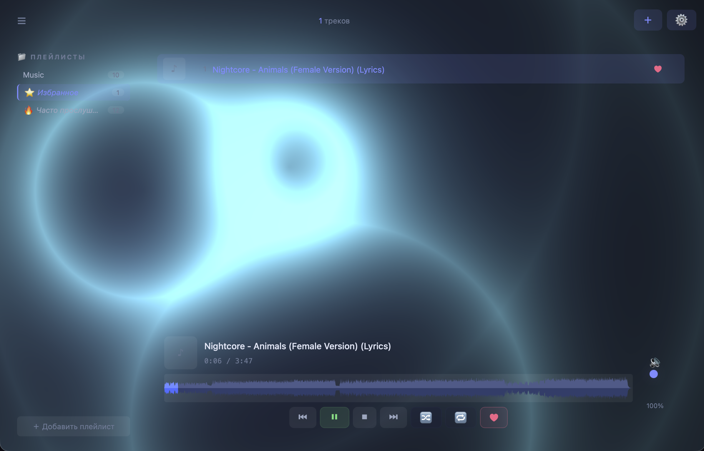

# ✦ MusicPlayer

Музыкальный плеер для macOS, написанный на Python + pywebview + VLC. Сделан под себя, так как встроенный плеер в MacOS не удовлетворят потребности автора. 



---

## Возможности

- Воспроизведение всех популярных аудиоформатов через libvlc
- Плейлисты с поддержкой drag & drop
- Виртуальные плейлисты «Избранное» и «Часто прослушиваемое» на основе метаданных
- 10-полосный эквалайзер с пресетами и пользовательскими профилями
- Waveform с кэшированием (мгновенное переключение между треками)
- Обложки из тегов с кэшированием
- **Фоновый WebGL-визуализатор** — волны реагируют на громкость музыки
- **Две темы оформления:** «Стандартная» (с панелями) и «Magic» (прозрачные панели, только текст и волны)
- Настраиваемый акцентный цвет: 12 готовых пресетов + свой цвет через color picker
- **Синхронизация позиции** для визуализатора (слайдер + горячие клавиши `[` и `]`)
- Регулировка размера обложек в списке
- Контекстное меню трека: переименование, исполнитель, альбом, избранное
- Inline-переименование треков прямо в списке
- Горячие клавиши для управления воспроизведением
- Плавная бегущая строка для длинных названий
- Чтение метаданных через tinytag
- Волна через ffmpeg + numpy
- Управление с телефона — плагин `share`, QR-код в приложении, локальный пульт

---

## Темы оформления

### Стандартная



Для повседневного использования. Панели с фоном, чёткая структура, хорошая читаемость. Если нужно быстро найти трек, послушать музыку в фоне и не отвлекаться.

### Magic



Для тех случаев, когда хочется залипнуть и смотреть на визуализатор. Панели прозрачные — виден только текст, обложки и волны на фоне. Музыка оживает в танцующих кольцах. Читаемость местами страдает, зато эстетика на первом месте.

---

## Требования

- macOS (проект заточен под Cocoa через pywebview)
- Python 3.10 или выше
- VLC (libvlc)
- ffmpeg (для генерации waveform)

Python-зависимости ставятся автоматически установщиком, но если хочешь вручную:

- pywebview
- python-vlc
- tinytag
- numpy
- pydub
- pyinstaller

---

## Скачивание

Скачать проект можно тремя способами.

### Способ 1: Скачать ZIP (проще всего)

1. На этой странице найди **зелёную кнопку** `<> Code` (справа сверху над списком файлов).
2. Нажми на неё — откроется меню.
3. Выбери **«Download ZIP»**.
4. Открой папку **Загрузки** — там появится файл `WebPlayer-main.zip`.
5. Двойной клик по архиву — macOS распакует его в папку `WebPlayer-main`.
6. **Готово.** Дальше — раздел «Установка».

### Способ 2: Через Git

Через Git, при условии что он установлен в системе:

```bash
git clone https://github.com/terrachell/WebPlayer.git
cd WebPlayer
```

### Способ 3: Установка dmg

Скачайте dmg файл на странице [Releases](https://github.com/terrachell/WebPlayer/releases)
Перетащите MusicPlayer.app в Applications (Приложения)

После этого — раздел «Установка».

---

## Установка


- > MacOS может не дать просто так запустить приложение в целях соображений безопасности. В таком случае вам нужно зайти в настройки, найти пункт "Конфиденциальность и безопасность", пролистать в самый низ, нажать "Открыть в любом случае" и ввести пароль или TouchID. 

---

Запуск из исходного кода:

```
python3 -m venv env
source env/bin/activate
pip install -r requirements.txt
python app.py
```

---

## Структура проекта

```
music-player/
├── app.py                # точка входа, HTTP-сервер, API для pywebview
├── music_player.py       # логика плеера, плейлисты, метаданные, VLC
├── requirements.txt      # Python-зависимости (для ручного запуска)
├── LICENSE               # MIT
├── plugins/
│   ├── lyrics/
│   │   ├── index.html
│   │   ├── manifest.json
│   │   ├── script.js
│   │   └── style.css
│   └── share/
│       ├── index.html
│       ├── manifest.json
│       ├── script.js
│       ├── style.css
│       └── mobile.html
├── frontend/
│   ├── index.html        # главный экран
│   ├── styles.css        # основные стили
│   ├── settings.css      # стили окна настроек
│   ├── main.js           # логика UI, работа с API
│   ├── settings.js       # окно настроек, эквалайзер
│   ├── visualizer.js     # фоновый WebGL-визуализатор
│   └── shaders/
│       ├── vertex.glsl   # вершинный шейдер
│       └── ripple.glsl   # фрагментный шейдер (волны)
├── screenshots/
│   ├── standart.png
│   └── magic.png
├── icon.icns
└── icon.svg
```

---

## Горячие клавиши

- Пробел — пауза / воспроизведение
- Стрелка вправо — следующий трек
- Стрелка влево — предыдущий трек
- Стрелка вверх — громкость +5
- Стрелка вниз — громкость −5
- R — переключить режим повтора
- S — переключить shuffle
- B — показать / скрыть сайдбар
- `[` — сдвинуть синхронизацию визуализатора на −25 мс
- `]` — сдвинуть синхронизацию визуализатора на +25 мс

---

## Как это работает

Приложение состоит из двух частей: Python-бэкенда и веб-фронтенда, которые общаются двумя способами.

В режиме pywebview — через `window.pywebview.api`. Это нативный мост между JavaScript и Python, работает быстро и не требует сети.

~~В режиме браузера~~ — через HTTP. Локальный сервер на `localhost` отдаёт `frontend/` и принимает POST-запросы на `/api/<метод>`. Это позволяет открыть плеер в обычном браузере, если нужно. **Не работает**

Физически на ip можно зайти в браузере, но треки, состояние и все остальное, что решает Python-backend, отображаться не будет. В консоли будет предупреждение о неработоспособности API. 


> API не отвечает после 20 попыток.


За воспроизведение отвечает libvlc. За метаданные — tinytag. За waveform — ffmpeg, который декодирует аудио в сырой PCM, а numpy считает пики. Результат кэшируется на диск по ключу из пути файла, mtime, размера и количества точек. Это позволяет не пересчитывать волну каждый раз по несколько секунд. В настройках есть кнопка очистки кэша, если он разрастётся.

Фоновый визуализатор написан на WebGL. Волны рисуются фрагментным шейдером в реальном времени. Количество и сила капель зависят от локальной громкости трека — визуализатор адаптируется под каждый трек. Синхронизация с музыкой настраивается в настройках или горячими клавишами `[` и `]`.

---

## Как создавался проект

WebPlayer - Появился благодаря желанию написать замену для приложения "Музыка" на MacOS

### WebPlayer - v1.0.0

Локальный релиз появился спустя несколько дней, после начала проекта. В нем были доступны лишь некоторые функции, которые должны быть в **любом** плеере
- Предыдущий/Следующий трек
- Плей/Пауза/Стоп
- Управление громкостью
- Переключение треков по нажатии на его название в списке

Эта версия локальная и останется локальной. 

### WebPlayer - v2.0.0

Изменения и дополнения:

- Удаление треков из списка
- Обновленный дизайн
- Настройки
- Эквалайзер
- И многое другое.

Эта версия стала фундаментом для будущих обновлений, и была выложена в сеть.

### WebPlayer v3.0.0

WebPlayer 3.0 вышел относительно недавно, в него были добавлены:
- Профили эквалайзера
- Возможность загрузки плагинов
- Метаданные для треков
- Кеш WaveForm
- Шейдеры WebGL для фона
- Расширенные настройки
- Возможность загрузки плагинов
- Возможность добавить трек в избранное
- Динамические плейлисты "Недавно прослушанное" и "Избранное"

Данное обновление потерпело огромные изменения в формате хранения данных, которые несовместимы с предыдущими версиями. 

Разрабатывался проект при помощи AI. 
> Идея, архитектура, структура модулей и технические решения — мои.
Генерация кода, львиная доля документации и написание модулей — с помощью AI.

### Инструменты

- AI-ассистент — для генерации кода и документации
- Ручная работа — архитектура, ревью, отладка, тестирование, небольшая часть документации

---

## ChangeLog

- Фикс QR-кода в плагине `share`. Генерация перенесена на локальную библиотеку `qrcode.js`
  (без внешнего API). Убран дублирующий URL из UI. v3.3.2

- Добавлен плагин `share` для управления с телефона. QR-код генерируется в приложении,
  открывается локальный HTTP-пульт (play/pause/next/prev/seek/volume). Требуется Mac
  и телефон в одной Wi-Fi сети. v3.3.1 

- Фундаментальный фикс pause/resume — устранён откат позиции и мигание `00:00`.
  Позиция в UI читается только из VLC (единый источник правды). Громкость и кнопка
  play/pause на Mac обновляются при изменении с телефона. Debounce UI. v3.3.1 

- Задержка между переключениями m4a/aac треками. Исправлено в версии 3.2.1. 
  Исправлены мелкие недочеты касаемо frontend плагина lyrics. 

- Задержка между переключениями m4a/aac треками. Исправлено в версии 3.2.1. 
  Исправлены мелкие недочеты касаемо frontend плагина lyrics. 

- Добавлен API для загрузки плагинов. Теперь можно модифицировать плеер не трогая ядро
  Добавлены слоты для frontend плагинов. v3.2.0

- Добавлен визуализатор основанный на WebGL. Добавлена возможность его отключить и настроить
  Функция была добавлена в v3.1.0

- Waveform не перерисовывается при автоматическом переключении трека.
  Исправлено в v3.0.1.

---

## Планы

- поиск по библиотеке, сортировка треков
- мини-плеер, компактный режим окна
- WebSocket вместо HTTP polling для `mobile.html`
- HTTPS для `mobile.html` (на случай работы вне локальной сети)

---

## Управление с телефона (плагин share)

Плагин `share` позволяет управлять плеером с телефона через локальную сеть.

**Как это работает:**

1. На Mac в приложении открываешь **плагин share** (правый клик по слоту `content`).
2. В приложении появляется **QR-код**.
3. **Сканируешь** QR телефоном.
4. Открывается мобильный пульт — **play**, **pause**, **next**, **prev**, **seek**, **volume**.

**Требования:**

- Mac и телефон **в одной Wi-Fi сети**.
- Порт `8001` (или `PLAYER_PORT`) **свободен**.

**Ограничения:**

- Только **управление**. Плейлисты, настройки, добавление треков — **только** с Mac.

---

## Плагин Lyrics

**Как это работает?**

Плагин ищет рядом со звуковым файлом текстовый файл с тем же названием и расширением .lrc

В самом .lrc прописаны тайминги и текст песни. Плагин загружает файл и просто показывает в нужный момент
определенные строки, подсвечивая их контрастным белым цветом. 

**Важно**

Файл с текстом загружается только тогда, когда название точно совпадает с треком. 

```text
Песня: song.mp3
Текст: song.lrc
```

> Только в таком случае плагин сможет найти файл с текстом. 
В противном случае плагин оповести вас об отсутствии файла .lrc

---

## Лицензия

MIT — см. файл [LICENSE](LICENSE).
